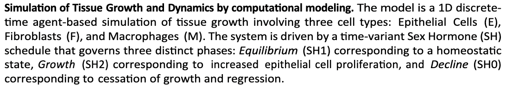
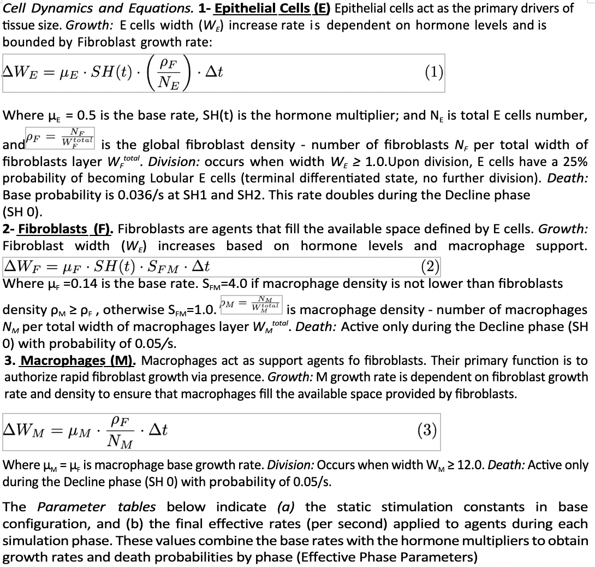
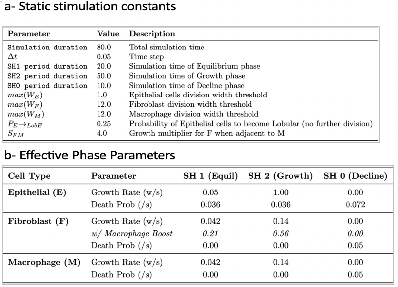

File tree as of January 29th 2026
```
release_package
├── README.md
├── grapher_v3.py
├── Makefile
├── massrunner.sh
├── simulation.py
├── table_exporter.py
├── visualization.py
└── visualize_graph.py

1 directory, 9 files
```

# Description

Below is the excerpt from the paper describing the structure of the model:

<!--



-->


Discrete-time 1D agent-based simulation of tissue growth and dynamics by computational modeling   simulation of tissue growth involving three cell types: Epithelial Cells (E), Fibroblasts (F), and Macrophages (M). The system is driven by a time-variant Sex Hormone (SH) schedule that governs three distinct phases: Equilibrium (SH1) corresponding to a homeostatic state, Growth (SH2) corresponding to increased epithelial cell proliferation, and Decline (SH3) corresponding to cessation of growth and regression. Initial configuration consists of 30 E cells, 3 F and 3 M. Each cell grows in width with the rate dependent on hormonal state (SH1, SH2, SH3) and local density of neighboring cell types. Each cell divides when reaches maximum width and dies with assigned probability.

### Cell Dynamics and Equations

Growth rates and death probabilities are defined as follows:

1. Epithelial Cells (E). Epithelial cells are agents that act as the primary drivers of tissue size. Growth: E cells width (WE) increase rate is dependent on hormone levels and is bounded by Fibroblast growth rate:

$$
\Delta W_E = \mu_E \cdot SH(t) \cdot (\frac{\rho_F}{N_E})\cdot \Delta t)
$$

Where µE = 0.5 is the base rate, SH(t) is the hormone multiplier; NE is total E cells number, and $\rho_F = \frac{N_F}{W^{\texttt{total}}_F}$ is the global fibroblast density - number of fibroblasts NF per total width of fibroblasts layer WFtotal. Division: occurs when width WE ≥ 1.0. Upon division, E cells have a 25% probability of becoming Lobular E cells (terminal differentiated state, no further division). Death: Base probability is constant 0.036/s. 

2. Fibroblasts (F). Fibroblasts are agents that fill the available space defined by E cells. Growth: Fibroblast width (WE) increases based on hormone levels and macrophage support.  

$$
\Delta W_F = \mu_F \cdot SH(t) \cdot S_{FM}\cdot \Delta t
$$

Where μF =0.14 is the base rate. SFM=4.0 if macrophage density is not lower than fibroblasts density ρM ≥ ρF , otherwise SFM=1.0. $\rho_M = \frac{N_M}{W^{\texttt{total}}_M}$ is macrophage density - number of macrophages NM per total width of macrophages layer WMtotal. Death: Active only during the Decline phase (SH3) with probability of 0.05/s. 

3. Macrophages (M). Macrophages act as support agents for fibroblasts. Their primary function is to authorize rapid fibroblast growth via presence. Growth: M growth rate is dependent on fibroblast growth rate and density to ensure that macrophages fill the available space provided by fibroblasts

$$
\Delta W_M = \mu_M \cdot \frac{\rho_F}{N_M} \cdot \Delta t
$$

Where μM = μF is macrophage base growth rate. Division: Occurs when width WM ≥ 12.0. Death: Active only during the Decline phase (SH3) with probability of 0.05/s. 
The tables below list (a) global parameters and (b) the final effective growth parameters applied to agents during each simulation phase, which include the base growth rates with the hormone multipliers to obtain growth rates and death probabilities by phase. Simulations start with the same initial cell numbers, each cell assigned randomized width. Simulations were repeated 10 times to obtain average dynamics of E, M, F numbers over time.

#### Simulation constants
| Parameter |	Value	 | Description |
| - |-|-|
| Simulation duration	| 80.0	| Total simulation time| 
|Δt	|0.05	| Time step
|SH1 period duration	|20.0	|Simulation time of Equilibrium phase|
|SH2 period duration	|50.0	|Simulation time of Growth phase|
|SH3 period duration	|10.0	|Simulation time of Decline phase|
|max(WE)	|1.0	|Epithelial cells division width threshold|
|max(WF)	|12.0	|Fibroblast division width threshold|
|max(WM)	|12.0	|Macrophage division width threshold|
|P(E) → Lob E	|0.25	|Probability of Epithelial cells to become Lobular (no further division)|
|SFM	|4.0	|Growth multiplier for F when adjacent to M|

#### Effective Phase Parameters
| Cell Type	| Parameter	| SH 1 (Equil) | SH 2 (Growth)	| SH 3 (Decline) |
| - | - | - | - | - |
	| Epithelial (E) |Base growth rate (w/s)	| 0.05 |	1.00 |	0.00 |
	| | Death prob (/s)	|0.036|	0.036	|0.036|
	|Fibroblast (F)|Base growth rate (w/s)|	0.042	|0.14|	0.00|
	| | Growth rate at contact with macrophage|	0.21	|0.56|	0.00|
	| | Death prob (/s)|	0.00|	0.00|	0.05|
	|Macrophage (M)|Base growth rate (w/s)|	0.042|	0.14|	0.00|
	| | Death prob| (/s)|	0.00	|0.00|	0.05|


## Instalation

```
git clone https://github.com/andrei-akopian/efm_model/tree/main
```
or click the green dropdown at the top and download as `.zip`

Install dependencies via: `pip3 install -r requirements.txt`. There is nothing special, mostly Python standard library, `numpy`, `pandas`, and `matplotlib`.

And install [ffmpeg](https://ffmpeg.org/) necessary to create video. If you are on MacOS and have [brew](https://brew.sh/), this is easily done via `brew install ffmpeg`.

Tested on MacOS 27 and with python 3.12.

## Usage

To run simulations, use `simulation.py`, `visualization.py`, and `visualize_graph.py`. `simulation.py` preforms the full simulation start to finish, and exports the timeline to `.json` files. To view the `.json` files use the visualization scripts. The visualization scripts only visualize and don't simulate anything.

```sh
python3 simulation.py # interactive, will create similar to simulation_data_E30_F3_M3.json
# python3 simulation.py --default # will run with default m=3 f=3 e=30 settings
python3 simulation.py --m=0 # runs with 0 macrophages, will create simulation_data_E30_F3_M0.json file
# to generate graphs, run one or multiple simulation file through visualize_graph.py
python3 visualize_graph.py simulation_data_E30_F3_M3.json simulation_data_E30_F3_M0.json
# to create video, similarly run (beware the reendering is slow)
python3 visualization.py simulation_data_E30_F3_M3.json simulation_data_E30_F3_M0.json
```

`simulation.py` should take about ~2s to run for an 80 second simulation and 30/3/3 initial cell counts. `visualize_graph.py` should take a compareable ~2s on the simulation's output. `visualization.py` (reendering video) can take up to 5 minutes depending on the settings.

Video and image outputs of the above code are in [example_outputs](example_outputs) folder. The `.json` files are big (~20MB in size) and were excluded.

Alternatively, look at `Makefile` and run preset scripts with `make <command>` like `make doublegraph`

`simulation.py` has arguments:
```
-h, --help     show this help message
--e E          Initial Epithelial cells (default: 30)
--lobec LOBEC  Proportion of LobEC cells (default: 0.5)
--f F          Initial Fibroblasts (default: 3)
--m M          Initial Macrophages (default: 3)
--default      Run default configuration (no interactive)
--seed SEED    set a specific seed
```

`visualization.py` has arguments:
```
--release             Render at full FPS. Default is fast preview (low FPS).
--gif                 Output a GIF file.
--speedup             Speed up final video playback by 1.5x.
```
Note that because reendering video is magnitudes slower than performing the simulations, by default only every 5th simulation step will be reendered. For a smoother simulation use `--release`. `--speedup` produces a faster video, it has no effect on the actual simulation.

---

To create a graph of the average of multiple simulations, use `table_exporter.py` and `grapher_v3.py`.

`table_exporter.py` will convert the json files to `.csv`s with time and cell count columns.

```sh
python3 table_exporter.py simulation_data_E30_F3_M3.json simulation_data_E30_F3_M0.json
```

`bash massrunner.sh` will simulate, convert to csv, and create a large number of simulations to be graphed. (Warning: it will flood the current directory with a large number of files.) Mass runner takes ~4s * number of simulations.

Then `grapher_v3.py` can graph their average and produce a `.svg` file containing the graph. It should take around ~1s per input file. However because `grapher_v3.py` is expected to be used on a large number of files at once, it doesn't accept the `.csv` files as arguments, and rather scans the derectories for `*_seed*.csv` wildcard marching files specifically. The text marched by the first star will be used to group the gaphs into `M0` and `M3` categories. Due to this complexity, `grapher_v3.py` best ran after `massrunner.sh`. 

```sh
python3 grapher_v3.py
```
